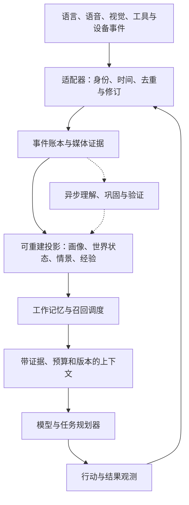

**Nyx 整体架构与演进规划 · 2026-11-20**

规划基线：`sixgodgit/nyx` main / v7.24.1，提交 `4f05ddbf9860517fbd7f84cd2c15aa70bfcc13e6`，已只读核对远端。本文是目标架构基线，不是当前完成度、性能测试或竞争产品排名。当前实现与验证进度见 [PLAN.md](../../PLAN.md)，M1-01 的后续本地交付单独登记。

**1. 产品定位与成功标准**

建议定位：以人为中心、面向长期运行智能体的记忆内核，支持跨会话、跨设备积累经历，维护可追溯的当前认识，并根据纠正和行动结果持续更新。

近期以 Hermes / Conduit 的长期个人助理体验验证价值；中期用一个可复现的具身任务验证对动态环境和行动的帮助。保持本地优先、单用户默认、基础记录确认不依赖 LLM。多设备不等于立即建设多租户云服务。

用户体验的成功应同时满足：

- 相关记忆无需用户点名工具即可在宿主允许的时机出现，且不干扰无关对话。
- 偏好变化、事实更正、指代和未完成任务能跨会话延续。
- 能区分“最后见过”“目前确认”“推测”“未知”，必要时请求重新观察。
- 能解释记忆来自哪里、为何进入上下文，且能纠正、隔离、恢复或永久删除。
- 在固定模型、工具和预算后，记忆能提高回答或行动结果，而不仅提高检索命中率。

**2. 当前基础与真正的架构缺口**

| 当前代码 | 可复用能力 | 下一步 |
| --- | --- | --- |
| `core/memid.py`、`sandglass_log.py` | 原始记录、稳定 ID、错误恢复、来源关联 | 明确单一事务权威，增加持久投影任务与崩溃恢复协议 |
| `runtime/facade.py`、`orchestrator.py` | 统一操作门面、多源召回、trace、预算和截止时间 | 用结构化请求贯穿身份、任务、场景、修订及客户端能力 |
| `core/profile.py`、`followups.py` | 当前偏好与禁忌、纠正、待跟进、遗忘联动 | 成为统一投影与上下文编排的组成部分 |
| `engram/loops/temporal_fact.py` | 有效时间与记录时间分离 | 扩展到对象状态、最后确认、冲突假设和不确定性 |
| `runtime/bundle.py`、`MemoryContext` | 上下文槽位及结构化召回结果 | 收敛为所有宿主共用的带证据上下文协议 |
| `core/memory_provider.py` | Hermes 常驻、逐轮召回、写入；语音启动接口 | 让不同接入路径使用同一核心策略，保留宿主能力差异 |
| `media/` | 素材哈希、文件登记、片段与记忆关联、可插拔理解 | 接入真实附件/流事件，补实体身份、空间参照与版本 |
| `runtime/consolidation.py`、`engram/` | 巩固提案、快照、部分持久化、衰减 | 验证、重算、撤销、依赖删除和结果反馈闭环 |

v7.23.1 已修复的可靠性问题不应重新作为“尚未修复缺陷”列出；v7.24.1 的语音启动记忆也应继续保留。当前仍需架构演进的边界包括跨 SQLite/文本文件的掉电事务、分别管理的常驻/逐轮预算、较窄的媒体表示，以及缺少完整的行动结果学习闭环。

**3. 目标结构**

权限、保留策略、遗忘、版本、可观测性贯穿全链路。感知模型、SLAM、地图、任务规划与运动控制通过适配器协作；Nyx 提供长期记忆和状态证据，不承担机器人高频运动闭环。

先采用模块化单进程核心：Python 库、SQLite、本地媒体文件、持久任务表。Hermes/MCP 直接调用；多设备确有需求时再增加本地 daemon 和可选网络服务。向量库、感知模型、ROS 2、模型裁判均为可选依赖，不要求核心引入 Kafka、远程向量数据库或 GPU。

**4. 统一数据契约**

不要另造一套平行记忆引擎。沿现有 `MemoryObject`、`MemoryContext`、`MemoryBundle` 和门面扩展以下模型，明确转换时必须保留的来源与生命周期信息。

| 对象 | 记录什么 | 关键约束 |
| --- | --- | --- |
| Event / Observation | 某人说了什么、传感器看到了什么、工具返回了什么、执行器报告了什么 | 事件发生并不保证内容为真；记录接入身份、设备、事件/接收时间、修订、证据引用 |
| Claim / Belief | 对主体及其状态的陈述、假设与当前认识 | 绑定事件证据、有效/记录时间、作用域、最后确认、不确定性、冲突与失效条件 |
| Episode | 围绕目标的一段经历与任务进展 | 关联目标、起始状态版本、动作尝试、预期、结果证据、成本、失败分类 |
| Procedure | 有条件、可验证的经验或步骤 | 保留适用条件、执行器版本、成功/失败证据与失效条件；默认先作为候选 |
| ContextPacket | 本次提供给宿主的工作上下文 | 包含证据 ID、版本、预算、截止时间、遗漏和过时状态；是查询结果，不是新的事实来源 |

统一请求至少携带：owner/principal、agent、device、session、turn、task、scene、时间范围、输入修订号、预算、deadline、允许的数据作用域及宿主能力。身份与权限来自接入层，不能由消息正文自行声明。会话 ID 本身不是授权凭证。

特别需要分开的维度：

- **指令权限与事实可信程度**：用户有权表达偏好，但对物体位置的判断也可能过时；摄像头可提供位置证据，却无权制定长期规则。
- **检索权重、事实有效性和物理保留期**：被读过多次不使错误变真；不常被检索不自动使事实失效；降权不等于永久删除。
- **独立证据与重复加工**：同一原文出现在五个索引或三次摘要中，仍是一份来源，不应算多次确认。
- **最后看到与现在所在**：状态必须附带时间、新鲜度和依据。不能把“昨天在桌上”无条件写成“现在在桌上”。

**5. 可靠存储、隔离与生命周期**

目标建议采用单一 SQLite 事务账本：事件元数据、原文/载荷引用、来源、幂等键和待投影任务在同一事务内确认；全文、向量、画像、世界状态、摘要均是可重建投影。文本日志继续提供便于检查和导出的格式。

基础写入返回 `durable / projection_pending / ready / failed` 等明确状态。投影使用持久 checkpoint、幂等任务和可重试执行；承诺至少一次执行加幂等效果，不宣称分布式“恰好一次”。模型不可用时仍可确认基础记录。

媒体先暂存并核验，再提交引用。崩溃留下的孤立文件可被清理；已确认事件引用的素材必须能按已选持久化策略恢复。高频流有环形缓存、容量配额、保留期和背压，不把全部视频帧永久转写进文本日志。

以显式 `MemoryStore / StoreContext` 逐步替换依赖进程全局路径的存储访问。默认一位所有者一个存储空间；跨档案、设备或任务共享必须显式授权。物理内容去重不能绕过逻辑资产的授权及保留规则。

每种派生物登记 source IDs、处理器/模型版本、权限作用域与保留策略。遗忘首先阻断读取并更新失效版本，随后按依赖处理投影、摘要、快照、媒体和缓存；保留可恢复隔离的现有语义。对于 Nyx 管理范围外的备份、导出或已发送给远端模型的上下文，明确报告覆盖边界，不能声称远端已撤回。

“只追加”的事件语义不应妨碍删除：纠正以新事件表达；被删除的内容载荷仍须按政策清除，必要墓碑只保留防复活所需的最少信息。不得把明文复制到不可删除的审计日志。

**6. 感知召回与工作记忆**

工作记忆维护当前任务、对话指代、近期场景、未完成事项、已提供证据及其版本。它是有边界的活动状态，不是无上限扩张的聊天历史。

采用三条由同一策略编排的路径：

| 路径 | 用途 | 行为 |
| --- | --- | --- |
| 常驻上下文 | 身份、适用的长期偏好/约束、当前任务与到期事项 | 预构建并版本化，按作用域选入；避免无关私人信息常驻每一轮 |
| 事件触发预取 | 稳定话段、指代、实体出现、任务变化、环境状态变化 | 后台生成候选；新修订取消或淘汰旧结果，限制频率、并发和预算 |
| 显式深检索 | 多跳追问、历史比较、证据不足或存在冲突 | 返回证据、未知与重新确认建议，必要时增加查询成本 |

统一最终上下文预算，覆盖画像、任务、跟进及检索证据；先保证适用的关键约束和纠正信息不被无关候选挤掉。宿主已有系统提示、工具和历史所占预算由适配器参与协商。输出遵守模型上下文上限，完整保留否定、主体、时间与来源。

“何时自然使用记忆”还需宿主支持。语音当前已有启动记忆，后续应按稳定转写片段预取，用 session/turn/revision 绑定结果。临时 ASR delta 不直接晋升长期记忆；最终文本、更正和通话结束归档共用幂等身份，避免重复写入。

接入层明确声明是否支持回答前注入、会话中追加、取消/中断、结构化工具、上下文失效。ChatGPT 订阅 GPT-Live 不能套用公开 Realtime API 的回合控制。宿主无法暂停回答时，使用可验证的追加、下一轮生效或澄清策略，不能宣称每次回答前都已完成召回。迟到结果不得误注入下一轮。

自动提供事实不等于自动打扰用户。主动跟进需尊重当前任务、适配的通知渠道、用户偏好、冷却时间和去重；只在有充分依据时触发。

**7. 具身世界状态与行动经验**

先完成一个明确任务：在持续变化的房间中，记住目标物体曾在哪里，识别移动与遮挡，证据过时时重新观察，并减少寻找时间。先固定感知器和规划器，在仿真中验证，再进入实机。

世界状态投影至少表达实体 ID、状态属性、位置及参照系、观测时间、最后确认、证据、关联不确定性和状态版本。地图/坐标变换引用外部有版本的系统；身份跟踪由感知适配器提供或协同维护。不确定性先采用有依据的等级/区间，不能用无校准的小数冒充概率。

位置变化、遮挡和失联要产生不同状态。缺少观察通常不能证明物体不存在；身份关联不确定时保留候选，不立即覆盖旧实体。不同传感器冲突应保留来源及假设，避免只按最新时间戳决定真相。

行动闭环为：目标及状态版本 → 动作尝试 → 执行报告 → 结果观测 → 归因 → 经验候选 → 验证 → 激活。记录结果证据与执行器/环境版本。高检索次数或一次偶然成功不足以提炼为技能；反馈还需区分感知、记忆、规划、工具和执行失败。记忆输出不能替代执行器自身的实时约束检查。

**8. 巩固、评测与可观测性**

巩固统一采用 `proposed → validated → persisted → activated` 状态，区分未实现的提案和真正已生效变更。新抽象保留证据与不确定性，不能因为进入“梦境”处理就提高指令权限或成为确认事实。任务反馈、消融和留出场景决定其是否进入核心路径。

现有梦境、情绪、人格和熟悉度模块可继续作为可选插件。保留其有用能力，但每项都要说明调用方、状态、成本、依赖和任务收益；不得只因名称类似认知机制就列为核心能力。

评估同时覆盖：检索命中 → 注入后证据可见 → 模型理解与遵守 → 用户任务/行动结果。保留 LongMemEval、LoCoMo、BEAM 与个人场景评测，分别报告检索指标和 QA 指标。

固定模型、工具、上下文预算和任务条件，对照无长期记忆、最近历史、BM25、向量检索、当前 Nyx 与新架构；增加去掉工作记忆、状态时效、更正或反馈的消融。训练/开发/留出按人物、场景或事件划分，避免同一经历的改写泄漏。

重点指标：

- 自然语言/语音：必要事实可见率、过时事实使用率、无关注入、错误跟进、跨轮迟到注入、端到端记忆生效延迟。
- 具身：寻找耗时、行动成功率、重复搜索、错误确定性、重新观察代价及位置/身份状态的新鲜度。
- 工程：写入确认延迟、投影积压、冷/热读取 p95/p99、数据集规模、硬件、模型成本、丢失/重复/隔离错误、崩溃恢复和删除覆盖率。

任何毫秒目标都先定义数据规模、硬件和冷/热条件，再冻结基线。本方案不把当前几十毫秒的文本检索数据外推到视觉、网络或完整语音通道。发布硬门禁包括定义范围内的来源隔离、幂等、修订乱序、更正、删除/恢复、迁移与故障注入；测试通过不等于证明永无故障。

为每次上下文生成保留不含秘密的 trace：数据/模型/索引版本、候选来源、选入与排除理由、预算、deadline、投影水位、场景版本、遗忘失效版本、宿主实际应用确认。`doctor` 显示真实数据目录、运行版本、待处理任务和降级原因。宿主没有确认应用时，状态应为“已生成/已发送”，不能报告“已被模型使用”。

**9. 分阶段交付与验收**

| 阶段 | 交付 | 进入下一阶段的条件 |
| --- | --- | --- |
| M1：收敛内核 | 结构化请求/证据协议、StoreContext、统一预算、真实接入 trace；确定事务账本与投影契约 | 同一事件无论 Hermes/MCP/导入进入，来源与生命周期一致；同一请求的跨宿主差异可解释 |
| M2：连续交互 | 工作记忆、稳定语音话段预取、修订及取消、幂等写入、失效通知 | 在支持的客户端上验证记忆及时生效、不会跨轮误注入、通话归档无重复；长期对话留出评测优于 v7.24.1 |
| M3：动态世界 | 一种仿真环境、实体/时空状态、证据时效与重新观察接口 | 固定感知/规划下，比当前文本记忆及基线减少搜索成本，不通过增加错误确定性换分 |
| M4：经验闭环 | Episode、action/outcome、可验证经验候选、巩固依赖与失效 | 留出场景中提高任务结果；错误经验能撤销，删除证据会传播到候选经验 |
| M5：多设备与生态 | 可选 daemon、设备身份/同步、缓存失效、SDK/协议兼容矩阵 | 存在真实跨设备需求且核心路径已稳定，再承担同步与冲突成本 |

M1 与 M2 可以按接口契约小步交错推进；持续保留评测与兼容性检查，不让世界状态或机器人依赖拖慢现有个人记忆产品。估期需结合维护人数与客户端修改权限，不以未经评估的周数承诺交付。

优先进入下一批开发的五件事：

1. 定义 RecallRequest / EvidenceRef / ContextPacket，并为来源、修订、预算及超时建立契约测试。
2. 将 Hermes 常驻、语音启动、逐轮预取的策略与最终预算收敛；保留旧接口作为适配层。
3. 引入显式 StoreContext 和每档案隔离测试；完善持久投影任务与状态水位。
4. 在一个真实支持的语音客户端上打通稳定转写 → 预取 → 应用确认 → 幂等归档；订阅通道限制单独记录。
5. 建立长周期对话回放与动态找物任务的固定基线；先量化收益再扩展技能学习。

**10. 迁移、兼容与发布纪律**

不进行整体重写。先把现有模块挂到稳定契约下，再替换内部实现。旧数据、工具名和公开接口使用显式适配器；核心依赖保持精简。

从文本权威切换到 SQLite 事务账本必须是独立设计决策：先离线导入保留 canonical IDs、来源和墓碑，影子投影比较数量/哈希/召回/删除结果；切换前在写锁与 checkpoint 下补齐增量，原子切换存储清单，确保只有一个权威写入方。不能让文本与数据库长期各自声明权威。

切换后旧备份不是直接回滚按钮：需要重放切换后事件或证明可无损转换；无法无损回退时停用新功能并保留新账本，不能静默丢弃新增记忆。验证掉电窗口、任务重试、重建后墓碑、媒体载荷及备份删除边界。

发布前必须核对包版本、插件清单、依赖最低版本、更新日志、测试和干净环境 wheel 安装。对 Hermes 稳定版/候选版及实际支持的客户端维护兼容矩阵。协议通过能力协商表达启动读取、逐轮查询、写入、更新/失效等支持项，减少依赖两边同时更新的隐含约定。

PR 使用目标仓库当前模板、最新目标分支和预检；版本冲突或上游规则变化需显式处理。先小范围启用、再扩大默认范围，每个阶段保留可验证的降级及数据恢复路径。

最终竞争力应由三个闭环共同证明：用户经历可持续积累，当前情境能及时得到正确记忆，行动或纠正能更新下一次判断。架构和评测都围绕这三个闭环收敛。
